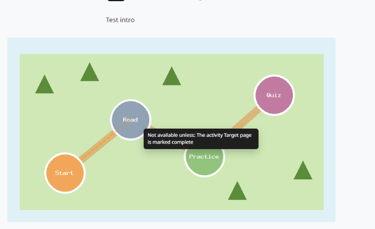

moodle-mod_imagemap
===================

**Turn an image into a map of your course: each area leads to an activity or section and shows whether it is open for the student.**

   An image map: open areas are shown normally, restricted areas are greyed out, and arrows show the path between them.

* **Draw on your own image.** Rectangles, circles and polygons, moved and resized with the mouse.
* **Link to activities and sections.** Each area opens a course activity or section.
* **Follows access restrictions.** An area whose target is not available yet gets its "inactive" style and, when clicked, tells the student why.
* **Show the path.** Draw arrows between areas to suggest an order.
* **Style each area.** Visual CSS for the active and inactive states, with ready-made examples kept by the administrator.

Versão em português: `Português (Brasil) <../pt-br/index.html>`_.

.. toctree::
   :maxdepth: 2
   :caption: Contents

   installation
   configuration
   usage
   backup_restore

Main features
-------------

* **Area editor**: select, rectangle, circle, polygon, line and eraser tools on a canvas over the image.
* **Targets**: course activities and sections, including subsections.
* **Restrictions and completion**: the state of each area comes from the availability of its target for the current user; teachers always see every area as active.
* **Safe CSS**: only visual properties are kept; values with ``url()``, ``expression()``, quotes, braces or comments are dropped.
* **Backup, restore and duplication**: areas and lines are kept and their targets point to the activities and sections of the restored course.
* **Moodle 4.5 LTS and 5.3 LTS**: tested on a CI matrix with PostgreSQL and MariaDB.

Links
-----

* Source code and issues: https://github.com/moodle-by-kelsoncm/mod_imagemap
* Moodle Marketplace: https://marketplace.moodle.com/plugins/mod_imagemap
