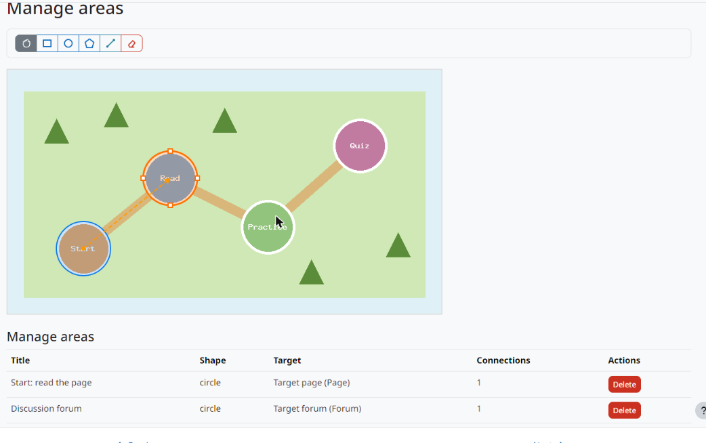

Usage
=====

Create the activity
-------------------

1. In a course with editing on, choose *Add an activity or resource > Image Map*.
2. Give it a name and upload the image.
3. Save, then open the activity and choose **Manage areas**.

The area editor
---------------

   The area editor.

The toolbar has these tools:

* **Select**: click an area to select it, drag it to move it and drag its handles to resize it. On a selected polygon, double-click an edge to add a vertex, or a vertex to remove it.
* **Rectangle** and **Circle**: drag on the image to draw the shape.
* **Polygon**: click each vertex, then **Finish**.
* **Line**: click the source area, then the destination area, to draw an arrow between them.
* **Eraser**: click a line or an area to delete it, after confirming.

Right-click an area to edit it. When a shape is drawn or edited, a form asks for:

* **Title**: shown when the pointer is over the area.
* **Target**: the course section or activity that the area opens.
* **Active CSS** and **Inactive CSS**: the style of the area when the target is available or not. **View examples** opens the examples kept by the administrator; the preview updates while you type.

Moving and resizing an area, editing the vertices of a polygon and adding or deleting lines are saved at once. The list below the image shows every area with its target and number of lines; its **Delete** button removes the area and its lines.

What students see
-----------------

The image is shown on the activity page and on the course page. Each area gets the style of its state:

* **Active**: the target is available to the student. Clicking the area opens it.
* **Inactive**: the target is hidden or restricted (for example, by a completion condition). The area cannot be opened; clicking it shows the restriction message.

Lines are drawn as dashed arrows from the source to the destination area.
